<p align="center">
  
</p>

<p align="center">
  
</p>

<p align="center">
  
  
  
</p>

<p align="center">
  
</p>

```text
░▒▓█ BOOT SEQUENCE █▓▒░
[ OK ] kernel ............ C++ / Python
[ OK ] vision.core ....... OpenCV / YOLO
[ OK ] neural.link ....... TensorFlow Lite
[ OK ] embedded.bus ...... ESP32
[ OK ] llm.stack ......... LangChain / Ollama
[ ** ] caffeine .......... CRITICAL LOW
[ >> ] user digvijay ..... AUTHENTICATED
```

---

## `[01] // IDENTITY_MATRIX`

```cpp
class Netrunner {
public:
    string handle     = "Digvijay Ware";
    string university = "MIT World Peace University";
    string degree     = "B.Tech Computer Science";
    string loadout[]  = { "Artificial Intelligence",
                          "Computer Vision",
                          "Algorithms",
                          "Software Engineering" };
    string directive  = "Learn. Experiment. Build. Upgrade.";
};
```

> **SYSTEM NOTE:** I like understanding how technology works beneath the surface: algorithms, real-time vision, and the hardware it runs on.

---

## `[02] // PROJECT_DATABASE`

| ▣ MODULE | ▣ PAYLOAD | ▣ ACCESS |
|---|---|---|
| 🛰️ **TerrainLens** | Terrain understanding, elevation analysis and visual perception | [`>> JACK IN`](https://github.com/Digvijay-exe/TerrainLens) |
| ⚡ **Pulse** | IMU-based movement tracking and kinematic fatigue analysis | [`>> JACK IN`](https://github.com/Digvijay-exe/Pulse) |
| 🖋️ **InkLite** | Lightweight software project | [`>> JACK IN`](https://github.com/Digvijay-exe/InkLite) |
| ☢️ **Pipboy Assistant** | Personal assistant project | [`>> JACK IN`](https://github.com/Digvijay-exe/Pipboy-Assistant) |

---

## `[03] // CYBERWARE_INSTALLED`

<p align="center">
  
</p>

---

## `[04] // TELEMETRY`

<p align="center">
  
  
</p>

<p align="center">
  
</p>

---

## `[05] // OPEN_CHANNEL`

<p align="center">
  <a href="https://github.com/Digvijay-exe"></a>
  <a href="https://linkedin.com/in/digvijay-ware-57a007330"></a>
</p>

<p align="center"><i>"The future is built by those who experiment."</i></p>

<p align="center">
  
</p>
